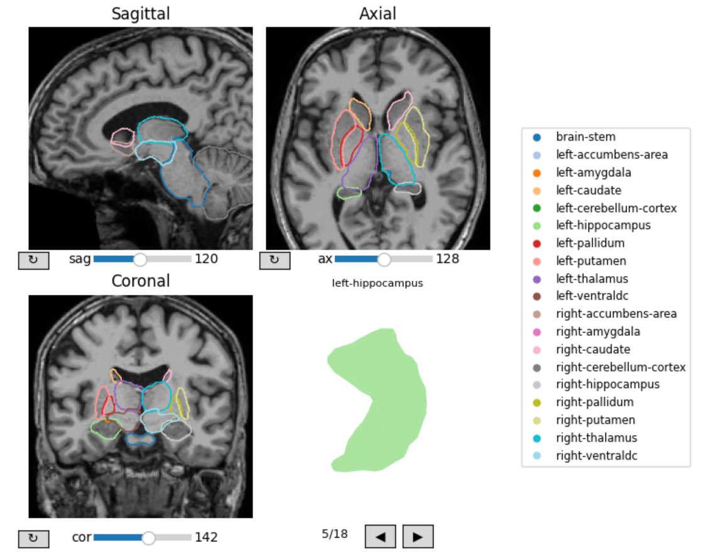
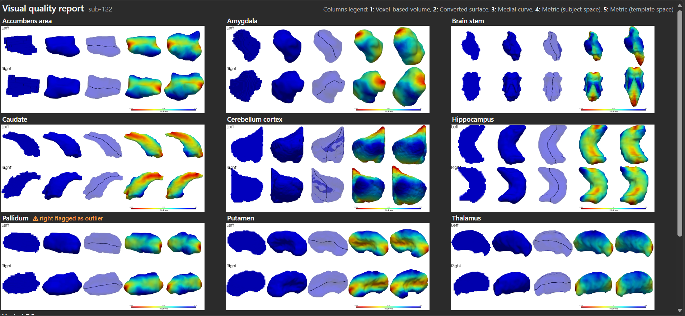
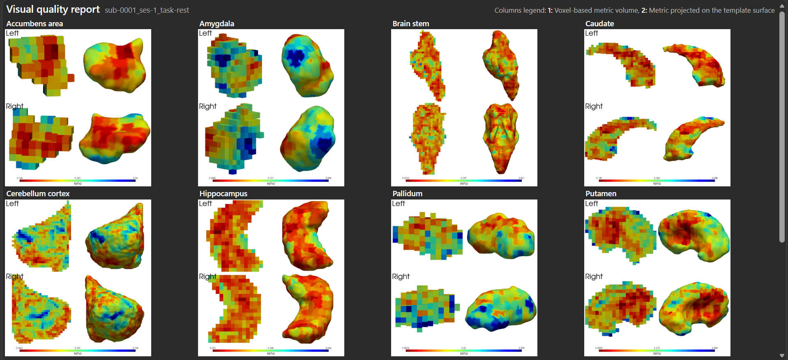

# Quality checks

This article introduces various tools users can use to inspect their processing outputs, beyond the interactive plotters that functions such as vol2surf() and mesh_metrics() include. 

## Visualising and inspecting converted surfaces meshes

For quality check, surfaces stored in "sub_surfaces" and generated by `vol2surf()` can be plotted together on top of a subject's corresponding volume with the *surf_qcplot()* function. Because the surfaces are based on a volume rigidly coregistered to fsaverage, the surfaces will match a volume coregistered with *subseg_getvol()*, i.e. "sub_volumes/sub-[id]/ants_coreg/T1\_[template]\_rigid_coreg.nii.gz" (or any volume likewise coregistered to the template):

``` python
from subcortexmesh import surf_qcplot
surf_qcplot(
    volpath="/my_outputdir/sub_volumes/sub-[id]/ants_coreg/T1_fsaverage_rigid_coreg.nii.gz",
    surfdir="/my_outputdir/sub_surfaces/sub-[id]",
    vol_color_map= "gray",
    outline_color_map = "tab20"
    )
```



Since regions will have been inflated and smoothed by default in *vol2surf()* to minimise graphical artefacts (e.g. hanging sparse voxels, sharp mesh spikes), the boundaries naturally appear slightly wider than their original anatomy and overlapping. Note that because the surfaces are processed by SubCortexMesh entirely separately, the visual overlap has no effect on later metrics values. In any event, this can be run on surfaces produced with dilate_erode=False.

## Flagging outliers

The *autoqc_outliers()* function helps quickly identify subject meshes that are outliers relatively to their cohort along five global heuristic shape features (volume, surface area, sphericity, elongation, symmetry). It returns a table stating for each subject and ROI, the number of features for which the ROI has been flagged as outlier (0-5).

``` python
from subcortexmesh import surf_qcplot, autoqc_outliers
flag_df = autoqc_outliers(inputdir="/my_outputdir/sub_surfaces/",
                          n_sd=2) #standard deviation at which to define outliers

#Using the table, one can specifically plot subjects and the concerned outlying ROIs, here for at least 4 outlying features:
for subid in flag_df.index:
    flagged_structures = [c for c in flag_df.columns if flag_df.loc[subid, c] >= 4]
    if not flagged_structures:
        continue
    print(f"{subid}: {flagged_structures}")
    surf_qcplot(
        volpath=f"{datapath}/ds003346_SCM/sub_volumes/{subid}/ants_coreg/T1_fsaverage_rigid_coreg.nii.gz",
        surfdir=f"{datapath}/ds003346_SCM/sub_surfaces/{subid}", 
        roilabel=flagged_structures)
```
A flagged ROI may still be fine and an anatomically correct segmentation, so users should inspect and decide for themselves whether it is valid or not. Outliers are relative to the values in the cohort and the features covered may be influenced by local structure changes such as brain volumes or ventricle volumes.

## Generating a visual report

Both data processed via the base SubCortexMesh pipeline (from FreeSurfer, FSL FIRST outputs) and from the [CIFTI data extraction](https://subcortexmesh.readthedocs.io/en/stable/cifti.html) steps can be automatically summarised into visual reports.  The reports are included in the `scm_all()` function. The visual report is a single .html file per subject with a page containing a screenshot of every processing stage for every subcortical region, helping doing quick quality checks.

This is done with the `visual_qc_report()` function, which can be run at the end of a processing pipeline. For example, for an output directory containing FreeSurfer data processed with subseg_getvol(), vol2surf() and mesh_metrics() (with the option native_meshes=True), one can run:

``` python
from subcortexmesh import visual_qc_report

visual_qc_report(inputdir="/my_outputdir/"
                 template="fsaverage",
                 metric_proj="thickness", #will show metric projection for that measure, can be many
                 outliers= "/my_outputdir/qc/autoqc_outliers.csv", #optional: generated with autoqc_outliers()
                 outlier_threshold=4, #optional: number of heuristic shape features the region should be outlying for, the outliers argument was given
                 #rows=3, #rows and columns of image to fit in the window
                 #columns=3,
                 #cmap='jet' #for the metrics 
                )
```

For the base pipeline, the .html contains plots of:
1. the subject's 3D volume (voxels, created by subseg_getvol()),
2. the subject's 3D surface mesh (converted from the volume by vol2surf()),
3. the surface (transparent) with its medial curve (computed by mesh_metrics()),
4. the metric data on the subject's surface (native/subject space, computed by mesh_metrics()),
5. the metric data projected on the template surface (projected by mesh_metrics()).

If an outlier table generated by autoqc_outliers() is provided (in the outliers argument), 
regions flagged as outliers will also be highlighted in the report.

The reports will be stored in a new figures/ directory, for example "sub-122_visual_quality_report.html":

(The right pallidum was manually highlighted as outlier for the sake of showing how a real outlier would be flagged)

If the output directory contains CIFTI outputs extracted with cifti_metrics() (the volumes must also be saved with the option keep_volumes=True), the same function can be run with cifti=True:

``` python
visual_qc_report(inputdir="/my_cifti_outputdir/"
                 template="fsaverage",
                 metric_proj="reho",  
                 cifti=True)
```

The report depicts:
1. the subject's 3D volume and metrics (voxel grayordinates with assigned values).
2. the metrics values projected to the fsaverage template surface (projected with cifti_metrics()).

